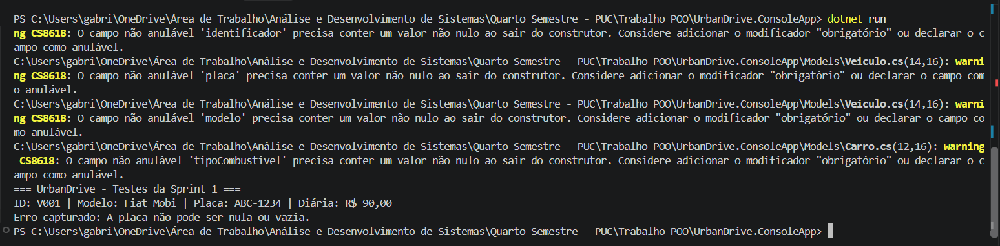

# RELATÓRIO DE AVALIAÇÃO — SPRINT 1
**Projeto:** UrbanDrive  
**Curso:** Análise e Desenvolvimento de Sistemas (PUC Minas)  

---

## 1. Product Backlog Inicial (Priorizado)
A lista de requisitos funcionais e estruturais mapeados para o desenvolvimento do sistema:

* **PBI-01 (Alta Prioridade):** Modelagem e cadastro base da entidade `Veiculo` (ID, placa, modelo e diária). *(Foco da Sprint 1)*
* **PBI-02 (Média Prioridade):** Especialização de veículos em subtipos (Carros, Motos e Patinetes) via herança.
* **PBI-03 (Média Prioridade):** Gestão de Motoristas (cadastro, CNH e validações).
* **PBI-04 (Média Prioridade):** Agrupamento e gestão de Frotas.
* **PBI-05 (Alta Prioridade):** Regras de negócio e cálculo de valores de locação.
* **PBI-06 (Baixa Prioridade):** Controlo de manutenção e peças dos veículos.
* **PBI-07 (Média Prioridade):** Configurações globais e contadores estáticos do sistema.
* **PBI-08 (Baixa Prioridade):** Geração de relatórios com uso de interfaces.
* **PBI-09 (Baixa Prioridade):** Gestão de veículos elétricos e estações de recarga.
* **PBI-10 (Alta Prioridade):** Interface de menu interativo via consola (*Console Application*).

### Sprint 1: Modelagem inicial e encapsulamento

| Responsável | Tarefa/Requisito | Iniciado em | Prazo | Status | Terminado em |
| :--- | :--- | :---: | :---: | :---: | :---: |
| Samuel Elias | Criação do repositório no GitHub Classroom e do projeto C# (.NET Console) | --/--/2026 | --/--/2026 | ✔️ | --/--/2026 |
| Gabriel Soares | PBI-01 / RF01: classe Veiculo (encapsulamento e validações) | --/--/2026 | --/--/2026 | ✔️ | --/--/2026 |
| Samuel Elias | Testes iniciais em Program.cs e evidências (print) | --/--/2026 | --/--/2026 | ✔️ | --/--/2026 |
| Gabriel Soares | Product Backlog + GitHub Projects (entregue com atraso) | --/--/2026 | --/--/2026 | 🔄 | --/--/2026 |
| Gabriel Soares / Samuel Elias | Documento da Sprint 1 no modelo A–H + retrospectiva | --/--/2026 | --/--/2026 | 🔄 | --/--/2026 |
| Samuel Elias | Ampliar testes (id vazio, modelo vazio, diária negativa, placa com espaços) | --/--/2026 | --/--/2026 | ⏳ | --/--/2026 |

---

## 2. Documento de Planeamento da Sprint 1

* **Objetivo da Sprint:** Estabelecer a arquitetura inicial da solução em C#, configurar o repositório colaborativo no GitHub e implementar a classe base `Veiculo` aplicando encapsulamento restrito e validações de dados essenciais.
* **Itens do Backlog Selecionados:** PBI-01 (Modelagem e cadastro base de veículos).
* **Tarefas Necessárias:**
  1. Criação do repositório no GitHub e convite aos membros da equipa.
  2. Inicialização do projeto C# (.NET Console Application).
  3. Codificação da classe `Veiculo` com atributos privados e propriedades públicas (`get`/`set` clássicos).
  4. Implementação de validações de negócio (bloqueio de placa nula/vazia e diária negativa).
  5. Escrita de rotinas de teste na classe `Program.cs`.
* **Responsáveis:** Todos os membros do grupo (desenvolvimento colaborativo).
* **Estimativa de Esforço:** 1 semana.
* **Critérios de Conclusão (Definition of Done):** 
  - Código compilado sem erros.
  - Validações a disparar exceções corretas em dados inválidos.
  - Repositório atualizado com o código funcional.
* **Incremento Demonstrável:** Versão funcional primária capaz de instanciar veículos válidos e rejeitar dados incorretos com mensagens controladas.

---

## 3. Evidências de Testes Realizados

A execução do código no terminal (`dotnet run`) validou com sucesso a criação correta de um objeto e a proteção contra dados inválidos:



```text
=== UrbanDrive - Testes da Sprint 1 ===
ID: V001 | Modelo: Fiat Mobi | Placa: ABC-1234 | Diária: R$ 90,00
Erro capturado: A placa não pode ser nula ou vazia.
<<<<<<< HEAD


# RELATÓRIO DE AVALIAÇÃO — SPRINT 2
**Projeto:** UrbanDrive  
**Curso:** Análise e Desenvolvimento de Sistemas (PUC Minas)  

### Sprint 2: Relacionamentos e membros estáticos

| Responsável | Tarefa/Requisito | Iniciado em | Prazo | Status | Terminado em |
| :--- | :--- | :---: | :---: | :---: | :---: |
| Gabriel Soares | PBI-02 / RF03: CNH e Motorista (composição) | --/--/2026 | --/--/2026 | ⏳ | --/--/2026 |
| Samuel Elias | PBI-03 / RF04: Frota (agregação com Veiculo) | --/--/2026 | --/--/2026 | ⏳ | --/--/2026 |
| Samuel Elias | PBI-04 / RF07: ConfiguradorSistema + contador estático | --/--/2026 | --/--/2026 | ⏳ | --/--/2026 |
| Gabriel Soares | PBI-05 / RF05: Locacao (associação Motorista–Veiculo) | --/--/2026 | --/--/2026 | ⏳ | --/--/2026 |
| Gabriel Soares | Diagrama de classes atualizado | --/--/2026 | --/--/2026 | ⏳ | --/--/2026 |
| Samuel Elias | Testes de integração e dos membros estáticos | --/--/2026 | --/--/2026 | ⏳ | --/--/2026 |
| Gabriel Soares / Samuel Elias | Planejamento, backlog atualizado e retrospectiva da Sprint 2 | --/--/2026 | --/--/2026 | ⏳ | --/--/2026 |
=======
>>>>>>> b4e3a2e3187f10199a618a90a302ceb2cdfa7a15
