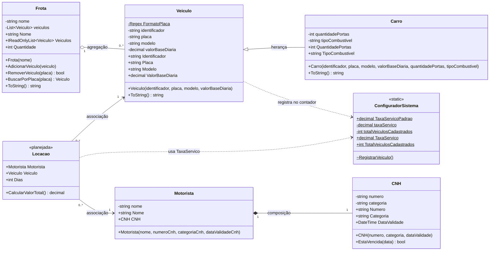

# Diagrama de classes — UrbanDrive

Versão atual: **Sprint 2** (relacionamentos entre objetos e membros estáticos).

O histórico deste arquivo no repositório mostra a evolução do diagrama a cada sprint.

## Legenda

| Símbolo | Significado |
|---|---|
| `+` / `-` / `~` | Público / privado / interno (`internal`) |
| `$` | Membro estático |
| `<|--` | Herança |
| `o--` (losango vazio) | Agregação: a parte existe independentemente do todo |
| `*--` (losango cheio) | Composição: a parte é criada pelo todo e não existe sem ele |
| `-->` | Associação |
| `..>` | Dependência (uso) |

## Relacionamentos

- **Herança — `Carro` → `Veiculo`:** `Carro` reaproveita os dados e as validações de `Veiculo` e repassa os valores comuns pelo construtor com `base`.
- **Agregação — `Frota` ◇ `Veiculo`:** os veículos são criados fora da frota e apenas adicionados a ela. Ao serem removidos, continuam existindo e podem entrar em outra frota.
- **Composição — `Motorista` ◆ `CNH`:** a `CNH` é criada dentro do construtor de `Motorista`, a partir dos dados recebidos, e não pode ser trocada por fora.
- **Associação — `Locacao` → `Motorista` e `Veiculo`:** a locação referencia um motorista e um veículo que existem independentemente dela.
- **Membros estáticos — `ConfiguradorSistema`:** classe estática com a taxa de serviço e o contador de veículos, compartilhados por todo o sistema. `Veiculo` registra cada veículo criado com sucesso, e `Locacao` usa a taxa no cálculo do valor total.

## Situação das classes

| Classe | Sprint | Situação |
|---|---|---|
| `Veiculo` | 1 | Implementada |
| `Carro` | 1 (protótipo da Sprint 3) | Implementada |
| `ConfiguradorSistema` | 2 | Implementada |
| `Frota` | 2 | Implementada |
| `Motorista` | 2 | Em desenvolvimento |
| `CNH` | 2 | Em desenvolvimento |
| `Locacao` | 2 | Planejada: membros representados conforme o planejamento, a revisar quando implementada |
