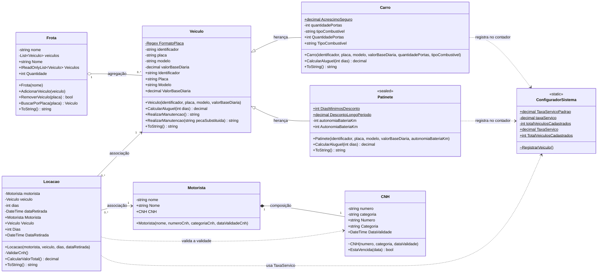

# Diagrama de classes — UrbanDrive

Versão atual: **Sprint 3** (herança, sobrescrita, sobrecarga, polimorfismo e classe `sealed`).

O histórico deste arquivo no repositório mostra a evolução do diagrama a cada sprint.

## Legenda

| Símbolo | Significado |
|---|---|
| `+` / `-` / `~` | Público / privado / interno (`internal`) |
| `$` | Membro estático |
| `<|--` | Herança |
| `o--` (losango vazio) | Agregação: a parte existe independentemente do todo |
| `*--` (losango cheio) | Composição: a parte é criada pelo todo e não existe sem ele |
| `-->` | Associação |
| `..>` | Dependência (uso) |

## Relacionamentos

- **Herança — `Carro` e `Patinete` → `Veiculo`:** as subclasses reaproveitam os dados e as validações de `Veiculo` e repassam os valores comuns pelo construtor com `base`. `Patinete` é `sealed`: nenhuma classe pode herdar dela.
- **Sobrescrita e polimorfismo — `CalcularAluguel(int dias)`:** `Veiculo` define o método como `virtual` (diária × dias). `Carro` (+5% de seguro) e `Patinete` (10% de desconto a partir de 3 dias) o sobrescrevem com `override`, chamando `base.CalcularAluguel(dias)`, sem repetir a regra nem a validação. `Locacao` chama `Veiculo.CalcularAluguel(Dias)` sem saber o tipo real do veículo.
- **Sobrecarga — `RealizarManutencao`:** `Veiculo` tem duas versões do método, sem parâmetro e com `string pecaSubstituida`, herdadas por todas as subclasses.
- **Agregação — `Frota` ◇ `Veiculo`:** os veículos são criados fora da frota e apenas adicionados a ela. Ao serem removidos, continuam existindo e podem entrar em outra frota.
- **Composição — `Motorista` ◆ `CNH`:** a `CNH` é criada dentro do construtor de `Motorista`, a partir dos dados recebidos, e não pode ser trocada por fora. O construtor da `CNH` é `internal`, indicando que ela não deve ser criada de forma independente.
- **Associação — `Locacao` → `Motorista` e `Veiculo`:** a locação referencia um motorista e um veículo que existem independentemente dela. Ao ser criada, rejeita motorista com CNH vencida na data de retirada.
- **Membros estáticos — `ConfiguradorSistema`:** classe estática com a taxa de serviço e o contador de veículos, compartilhados por todo o sistema. `Carro` e `Patinete` registram cada veículo no fim do próprio construtor, depois de todas as validações (Sprint 3), e `Locacao` usa a taxa no cálculo do valor total.

## Situação das classes

| Classe | Sprint | Situação |
|---|---|---|
| `Veiculo` | 1 (métodos polimórficos na Sprint 3) | Implementada |
| `Carro` | 1 (sobrescrita na Sprint 3) | Implementada |
| `Patinete` (`sealed`) | 3 | Implementada |
| `ConfiguradorSistema` | 2 | Implementada |
| `Frota` | 2 | Implementada |
| `Motorista` | 2 | Implementada |
| `CNH` | 2 | Implementada |
| `Locacao` | 2 | Implementada |
