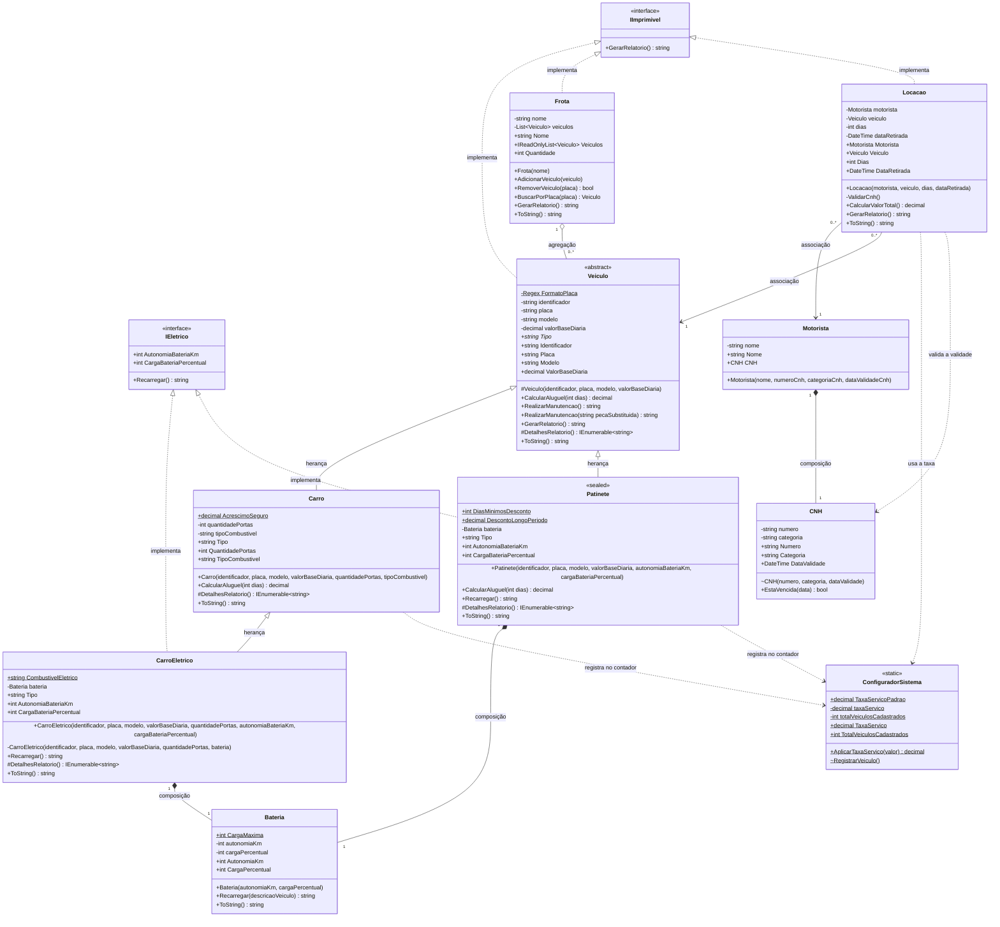
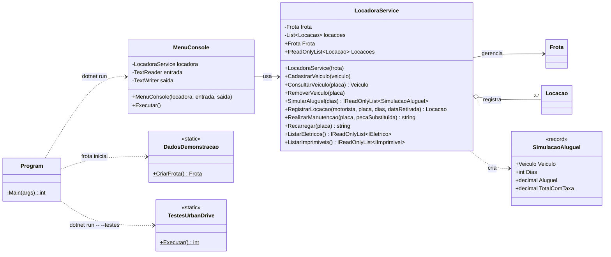

# Diagrama de classes — UrbanDrive

Versão atual: **final (Sprint 4)**: abstração, interfaces e consolidação do sistema.

O histórico deste arquivo no repositório mostra a evolução do diagrama a cada sprint.

## Modelo de domínio

## Aplicação de console

## Legenda

| Símbolo | Significado |
|---|---|
| `+` / `-` / `#` / `~` | Público / privado / protegido (`protected`) / interno (`internal`) |
| `$` | Membro estático |
| `*` (depois do nome) | Membro abstrato |
| `<<abstract>>`, `<<interface>>`, `<<sealed>>`, `<<static>>` | Classe abstrata, interface, classe selada, classe estática |
| `<|--` | Herança |
| `<|..` | Implementação de interface |
| `o--` (losango vazio) | Agregação: a parte existe independentemente do todo |
| `*--` (losango cheio) | Composição: a parte é criada pelo todo e não existe sem ele |
| `-->` | Associação |
| `..>` | Dependência (uso) |

## Relacionamentos

- **Abstração — `Veiculo`:** classe abstrata, com construtor `protected` e a propriedade abstrata `Tipo`, que cada subclasse implementa. Não pode ser instanciada; concentra os dados, as validações e as regras comuns.
- **Herança — `Carro` e `Patinete` → `Veiculo`; `CarroEletrico` → `Carro`:** as subclasses reaproveitam os dados e as validações da base e repassam os valores comuns pelo construtor com `base`. `Patinete` é `sealed`. `CarroEletrico` mostra a herança em dois níveis e herda o aluguel do `Carro`.
- **Sobrescrita e polimorfismo — `CalcularAluguel(int dias)`:** `virtual` em `Veiculo` (diária × dias). `Carro` (+5% de seguro) e `Patinete` (10% de desconto a partir de 3 dias) sobrescrevem chamando `base.CalcularAluguel(dias)`. `Locacao` e `LocadoraService.SimularAluguel` chamam o método sem saber o tipo real do veículo.
- **Sobrecarga — `RealizarManutencao`:** duas versões em `Veiculo`, sem parâmetro e com `string pecaSubstituida`.
- **Interface `IImprimivel`:** implementada por `Veiculo` (e, por herança, por todos os veículos), `Frota` e `Locacao`. Em `Veiculo`, `GerarRelatorio()` monta as linhas comuns e chama o método `protected virtual DetalhesRelatorio()`, que cada subclasse sobrescreve.
- **Interface `IEletrico`:** implementada por `CarroEletrico` e `Patinete`. O menu identifica os veículos elétricos com `is IEletrico`.
- **Composição — `CarroEletrico`/`Patinete` ◆ `Bateria`:** a bateria é criada pelo veículo e concentra as validações (autonomia > 0, carga de 0 a 100%) e a recarga, sem duplicar código entre as duas classes.
- **Agregação — `Frota` ◇ `Veiculo`:** os veículos são criados fora da frota e apenas adicionados a ela. Ao serem removidos, continuam existindo.
- **Composição — `Motorista` ◆ `CNH`:** a `CNH` é criada dentro do construtor de `Motorista` e não pode ser trocada por fora. O construtor da `CNH` é `internal`.
- **Associação — `Locacao` → `Motorista` e `Veiculo`:** a locação referencia objetos que existem independentemente dela e rejeita motorista com CNH vencida na data de retirada.
- **Membros estáticos — `ConfiguradorSistema`:** taxa de serviço e contador de veículos compartilhados. `Carro` e `Patinete` registram o veículo no fim do construtor, depois de todas as validações; `CarroEletrico` valida a bateria antes de chamar o construtor de `Carro`, para não ser contado se for inválido.
- **Aplicação — `Program` → `MenuConsole` → `LocadoraService`:** o `Program` só inicializa; o menu lê e exibe; o serviço executa as operações sobre a frota e as locações. Assim a regra de negócio não fica na aplicação de console.

## Situação das classes

| Classe | Sprint | Situação |
|---|---|---|
| `Veiculo` (abstrata) | 1 (polimorfismo na 3, abstrata na 4) | Implementada |
| `Carro` | 1 (sobrescrita na 3) | Implementada |
| `Patinete` (`sealed`) | 3 (`IEletrico` na 4) | Implementada |
| `CarroEletrico` | 4 | Implementada |
| `Bateria` | 4 | Implementada |
| `IImprimivel` | 4 | Implementada |
| `IEletrico` | 4 | Implementada |
| `ConfiguradorSistema` | 2 | Implementada |
| `Frota` | 2 (`IImprimivel` na 4) | Implementada |
| `Motorista` | 2 | Implementada |
| `CNH` | 2 | Implementada |
| `Locacao` | 2 (`IImprimivel` na 4) | Implementada |
| `LocadoraService`, `MenuConsole`, `DadosDemonstracao` | 4 | Implementadas |
| `TestesUrbanDrive` | 4 (testes das Sprints 1 a 4) | Implementada |
