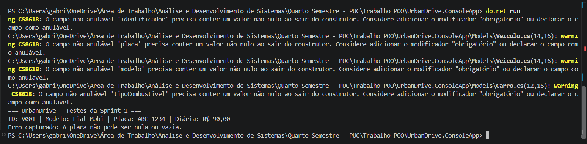

# Sprint 1 — Modelagem inicial e encapsulamento

## A. Identificação

- **Grupo:** Gabriel Soares e Samuel Elias
- **Integrantes:** Gabriel Soares, Samuel Elias
- **Número da sprint:** 1
- **Período:** 30/10/2026 a 31/10/2026
- **Responsável pelo acompanhamento:** Gabriel Soares

## B. Objetivo da sprint

Estabelecer a estrutura inicial do UrbanDrive em C# e entregar uma primeira versão executável que represente veículos, demonstrando encapsulamento (atributos privados e propriedades públicas) e validação dos dados na classe `Veiculo`.

## C. Itens selecionados do Product Backlog

| ID | Requisito | Prioridade | Justificativa |
|---|---|---|---|
| PBI-01 | RF01 — Gerenciamento de veículos | Alta | `Veiculo` é a base do sistema. Todos os demais itens (herança, frota, locação) dependem dela, e ela não tem dependências. |

## D. Planejamento das tarefas

Unidade das estimativas: **horas**.

| ID | Tarefa | Item relacionado | Responsável | Estimativa |
|---|---|---|---|---|
| T1.1 | Criar o repositório no GitHub Classroom e o projeto C# (.NET Console) | PBI-01 | Gabriel Soares | 1h |
| T1.2 | Implementar a classe `Veiculo` com atributos privados, propriedades públicas e construtor | PBI-01 | Gabriel Soares | 2h |
| T1.3 | Implementar as validações (identificador, placa nula/vazia, modelo e diária negativa) | PBI-01 | Gabriel Soares | 1h |
| T1.4 | Escrever os testes iniciais em `Program.cs` e registrar as evidências | PBI-01 | Samuel Elias | 1h |
| T1.5 | Ampliar os testes (id vazio, modelo vazio, diária negativa, placa com espaços e minúsculas) | PBI-01 | Gabriel Soares | 1h |
| T1.6 | Elaborar o Product Backlog e o quadro no GitHub Projects | PBI-01 | Gabriel Soares | 1h |
| T1.7 | Documentar a Sprint 1 (modelo A–H) e a retrospectiva | PBI-01 | Gabriel Soares e Samuel Elias | 1h |

## E. Critérios de aceitação

**PBI-01 — Entidade `Veiculo`**

1. Um `Veiculo` com identificador, placa, modelo e diária válidos é criado e exibe seus dados corretamente.
2. Criar `Veiculo` com **placa nula, vazia ou só com espaços** lança `ArgumentException` com a mensagem "A placa não pode ser nula ou vazia."
3. Criar `Veiculo` com **identificador ou modelo nulo/vazio** lança `ArgumentException`.
4. Criar `Veiculo` com **diária negativa** lança `ArgumentException`.
5. A placa é armazenada sem espaços nas extremidades e em maiúsculas (ex.: `" abc-1234 "` vira `ABC-1234`).
6. Os atributos são privados e só podem ser acessados pelas propriedades públicas.
7. O projeto compila sem erros e a aplicação executa com `dotnet run`.

## F. Entregáveis previstos

- Product Backlog inicial priorizado ([backlog.md](../backlog.md)).
- Este documento de planejamento.
- Código-fonte da classe `Veiculo` e do `Program.cs` de testes.
- Demonstração da criação de objetos e da validação das propriedades.
- Evidências de testes (saída do terminal e captura de tela).
- Registro do resultado e retrospectiva (seções G e H).

## G. Resultado da sprint

| Item ou tarefa | Situação | Evidência | Observações |
|---|---|---|---|
| T1.1 — Repositório e projeto C# | Concluído | Repositório no GitHub | |
| T1.2 — Classe `Veiculo` | Concluído | `Veiculo.cs` | |
| T1.3 — Validações | Concluído | `Veiculo.cs` e testes | |
| T1.4 — Testes iniciais | Concluído | Seção "Evidências de testes" abaixo | |
| T1.5 — Ampliação dos testes | Concluído | `Program.cs` | Tarefa reatribuída de Samuel Elias para Gabriel Soares. |
| T1.6 — Backlog e GitHub Projects | Concluído com atraso | [backlog.md](../backlog.md) | Entregue depois da entrega principal da sprint. |
| T1.7 — Documentação da sprint | Concluído | Este arquivo | |

**Item adiantado:** a classe `Carro` (prevista para a Sprint 3) já foi codificada como protótipo e será revisada na Sprint 3.

### Evidências de testes

Execução com `dotnet run`:



```text
=== UrbanDrive - Testes da Sprint 1 ===
ID: V001 | Modelo: Fiat Mobi | Placa: ABC-1234 | Diária: R$ 90,00
Erro capturado: A placa não pode ser nula ou vazia.
```

## H. Retrospectiva

**O que funcionou bem?**
A classe `Veiculo` foi implementada com encapsulamento e validações, e a estrutura inicial do repositório ficou pronta para as próximas sprints.

**Quais foram as principais dificuldades?**
- O Product Backlog não foi entregue junto com a sprint e foi formalizado depois.
- O documento de planejamento inicial não seguia o modelo A–H do enunciado e precisou ser refeito.

**O planejamento foi adequado ao esforço necessário?**
Em parte. As tarefas foram concluídas, mas o planejamento inicial não detalhava responsáveis e estimativas por tarefa. A partir da Sprint 2, cada tarefa terá responsável e estimativa em horas definidos antes do início.

**O que deverá ser melhorado na próxima sprint?**
- Entregar o backlog atualizado e o planejamento antes de iniciar o desenvolvimento.
- Dividir as tarefas entre os dois integrantes desde o planejamento.
- Trabalhar em branches com Pull Request revisado pelo colega, deixando as contribuições individuais identificáveis.
- Criar um projeto de testes automatizados (xUnit) em `tests/`.