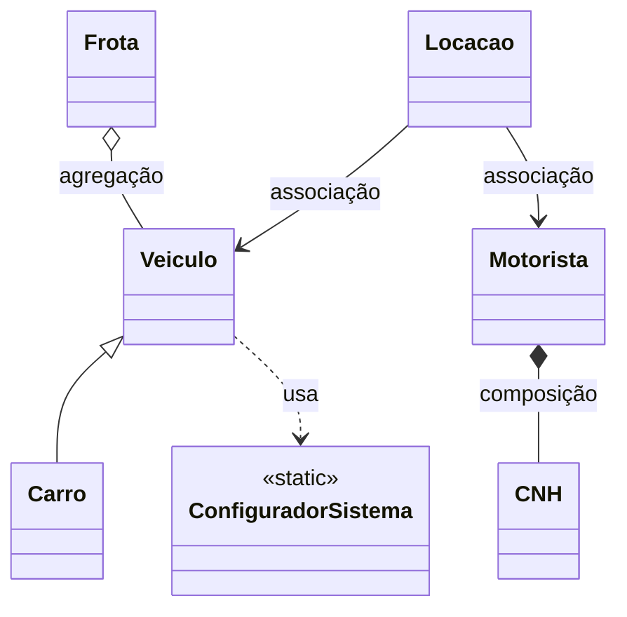
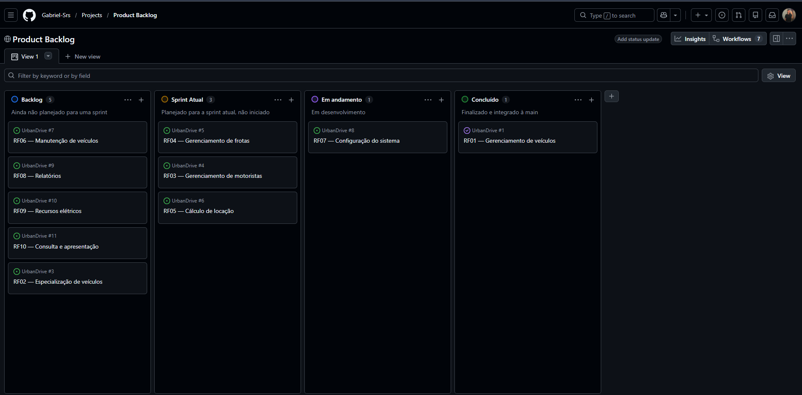
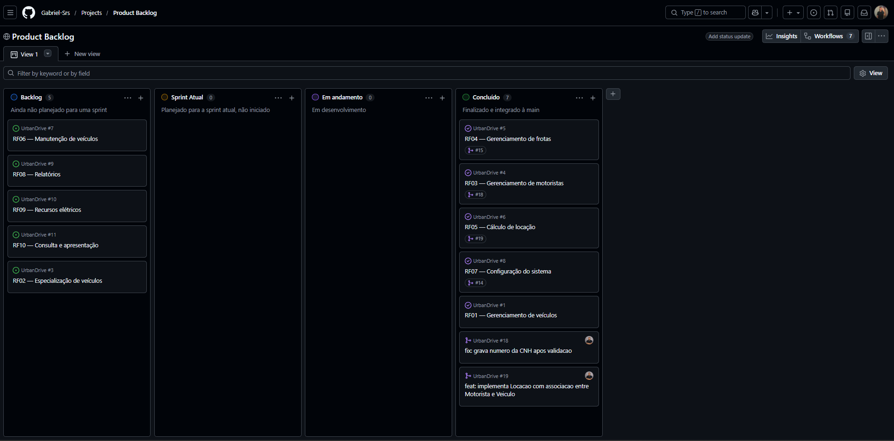

# Sprint 2 — Relacionamentos entre objetos e membros estáticos

## A. Identificação

- **Grupo:** Gabriel Soares e Samuel Elias
- **Integrantes:** Gabriel Soares, Samuel Elias
- **Número da sprint:** 2
- **Período:** 12/11/2026 a 14/11/2026
- **Repositório:** https://github.com/Gabriel-Srs/UrbanDrive
- **Quadro de acompanhamento:** GitHub Projects "Product Backlog"
- **Responsável pelo acompanhamento:** Samuel Elias

## B. Objetivo da sprint

Ampliar o modelo para que os componentes do sistema interajam entre si: `Motorista` contém `CNH` (composição), `Frota` gerencia uma coleção de `Veiculo` (agregação), `Locacao` relaciona `Motorista` e `Veiculo` (associação) e `ConfiguradorSistema` mantém informações compartilhadas por meio de membros estáticos.

## C. Itens selecionados do Product Backlog

| ID | Requisito | Prioridade | Justificativa |
|---|---|---|---|
| PBI-02 | RF03 — `Motorista` e `CNH` | Alta | Não tem dependências e é pré-requisito da locação. Exige composição. |
| PBI-03 | RF04 — `Frota` | Alta | Depende apenas de `Veiculo` (Sprint 1). Exige agregação. |
| PBI-04 | RF07 — `ConfiguradorSistema` | Média | Introduz membros estáticos e fornece a taxa usada no cálculo de locação. |
| PBI-05 | RF05 — `Locacao` | Média | Depende de PBI-01 e PBI-02. Demonstra a associação entre objetos. |

## D. Planejamento das tarefas

Unidade das estimativas: **horas**.

| ID | Tarefa | Item relacionado | Responsável | Estimativa |
|---|---|---|---|---|
| T2.1 | Implementar `CNH` (validações) e `Motorista` com composição | PBI-02 | Gabriel Soares | 4h |
| T2.2 | Implementar `Frota` com lista encapsulada e rejeição de placa duplicada | PBI-03 | Samuel Elias | 4h |
| T2.3 | Implementar `ConfiguradorSistema` estático e contador de veículos | PBI-04 | Samuel Elias | 3h |
| T2.4 | Implementar `Locacao` (associação Motorista–Veiculo) | PBI-05 | Gabriel Soares | 4h |
| T2.5 | Atualizar o diagrama de classes | PBI-02 a PBI-05 | Gabriel Soares | 2h |
| T2.6 | Escrever testes de integração e dos membros estáticos | PBI-02 a PBI-05 | Samuel Elias | 4h |
| T2.7 | Atualizar backlog, documentar a sprint e registrar a retrospectiva | Todos | Gabriel Soares e Samuel Elias | 2h |

## E. Critérios de aceitação

**PBI-02 — Motorista e CNH (composição)**
- Criar `Motorista` com dados de CNH inválidos (número diferente de 11 dígitos, categoria vazia) lança `ArgumentException`.
- Não é possível criar uma `CNH` fora de `Motorista` (construtor `internal`).
- A `CNH` é criada dentro do construtor de `Motorista`.

**PBI-03 — Frota (agregação)**
- Adicionar o mesmo veículo (mesma placa) duas vezes é rejeitado.
- Remover um veículo da `Frota` **não** o destrói: o objeto continua existindo e utilizável.
- A lista de veículos não pode ser alterada diretamente de fora da classe.

**PBI-04 — ConfiguradorSistema (estático)**
- `TotalVeiculosCadastrados` aumenta em 1 a cada `new Veiculo(...)`.
- `TaxaServico` fora do intervalo de 0 a 1 lança `ArgumentException`.
- A taxa é única e compartilhada por todo o sistema.

**PBI-05 — Locacao (associação)**
- Criar locação com motorista de CNH vencida é rejeitado.
- Criar locação com dias menores ou iguais a zero, ou com motorista/veículo nulo, é rejeitado.
- O total calculado usa a diária do veículo, a quantidade de dias e a taxa do `ConfiguradorSistema`.

**Geral:** o projeto compila, a aplicação executa e há demonstração da interação entre os objetos.

> **Revisão de critério (14/11/2026):** no PBI-02, o construtor `internal` não impede a criação de uma `CNH` fora de `Motorista`, porque todas as classes estão no mesmo projeto (`internal` restringe o acesso apenas entre projetos diferentes). O construtor foi mantido como `internal` para indicar a intenção, e a composição é garantida pela criação da `CNH` dentro do construtor de `Motorista`, sem `set` público e sem receber uma `CNH` pronta.

## F. Entregáveis previstos

- Este documento de planejamento.
- Product Backlog atualizado ([backlog.md](../backlog.md)).
- Diagrama de classes atualizado (abaixo).
- Código-fonte com `CNH`, `Motorista`, `Frota`, `ConfiguradorSistema` e `Locacao`.
- Demonstração da interação entre os objetos.
- Evidências de testes dos relacionamentos e dos membros estáticos.
- Registro das atividades concluídas e das pendências (seções G e H).

### Diagrama de classes (previsto)



O diagrama atualizado com as classes, atributos, métodos e relações implementados está em [docs/diagramas/diagrama-classes.md](../diagramas/diagrama-classes.md).

## G. Resultado da sprint

| Item ou tarefa | Situação | Evidência | Observações |
|---|---|---|---|
| T2.1 — `CNH` e `Motorista` (composição) | Concluído | Merge da `feature/motorista-cnh` e PR #18, `Models/CNH.cs`, `Models/Motorista.cs`, `TestarSprint2MotoristaCnh()` | 7 cenários de teste aprovados. Os próprios testes detectaram que o número da CNH não era gravado após a validação; corrigido no PR #18. O construtor da `CNH` passou a ser `internal` (ver revisão de critério na seção E). |
| T2.2 — `Frota` (agregação) | Concluído | PR #15, `Models/Frota.cs`, `TestarSprint2Frota()` | 13 cenários de teste aprovados. Lista exposta como `IReadOnlyList`; placa repetida e veículo nulo são rejeitados; veículo removido continua existindo e pode entrar em outra frota. |
| T2.3 — `ConfiguradorSistema` (membros estáticos) | Concluído | PR #14, `Models/ConfiguradorSistema.cs`, `TestarSprint2ConfiguradorSistema()` | 8 cenários de teste aprovados. Taxa padrão de 10%, aceita valores de 0 a 1. **Limitação conhecida:** um `Carro` rejeitado pelas próprias validações (ex.: 0 portas) é contado, porque o construtor de `Veiculo` executa antes do de `Carro`. Será tratada na Sprint 3, junto com a revisão da hierarquia. |
| T2.4 — `Locacao` (associação) | Concluído | PR #19, `Models/Locacao.cs` | Rejeita motorista ou veículo nulo, dias menores ou iguais a zero e CNH vencida na data de retirada. `CalcularValorTotal()` usa a diária, os dias e a taxa do `ConfiguradorSistema`, isolado para receber o cálculo polimórfico na Sprint 3. |
| T2.5 — Diagrama de classes | Concluído | [`docs/diagramas/diagrama-classes.md`](../diagramas/diagrama-classes.md) | Tarefa redistribuída entre os integrantes e executada por Samuel Elias. Diagrama em Mermaid com atributos, métodos, visibilidade, membros estáticos e as relações de herança, agregação, composição, associação e dependência. Atualizado no fechamento da sprint com os membros reais de `Locacao` e o construtor `internal` da `CNH`. |
| T2.6 — Testes de integração e dos membros estáticos | Concluído | `Program.cs`, `TestarSprint2Locacao()` | 14 cenários de integração: locação de veículo buscado na `Frota`, referência aos mesmos objetos (associação), cálculo com a taxa padrão e com a taxa alterada no `ConfiguradorSistema`, locação de um `Carro`, validade da CNH e rejeições. Total do projeto: 57 aprovados, 0 reprovados. |
| T2.7 — Backlog, documentação e retrospectiva | Concluído | Este documento, [backlog.md](../backlog.md) | |

**Mudança na organização dos testes:** o `Program.cs` passou a ter um método de testes por funcionalidade (`TestarSprint1Veiculo`, `TestarSprint2ConfiguradorSistema`, `TestarSprint2Frota`, `TestarSprint2MotoristaCnh`, `TestarSprint2Locacao`), para que os integrantes possam adicionar testes em paralelo sem conflitos.

### Evidências

**Quadro do GitHub Projects no início da sprint:**



**Quadro do GitHub Projects no fim da sprint:**



**Execução com `dotnet run` (compilação sem avisos), seções da Sprint 2:**

```text
##### Sprint 2: ConfiguradorSistema #####

--- Contador de veículos (estático) ---
Veículos cadastrados até agora: 4
[OK] Criar 2 veículos válidos (Veiculo e Carro) aumenta o contador em 2: ok
[OK] Criar veículo com placa vazia é rejeitado: A placa não pode ser nula ou vazia.
[OK] Veículo rejeitado não aumenta o contador: ok
Veículos cadastrados agora: 6

--- Taxa de serviço (estática e compartilhada) ---
[OK] Taxa começa com o valor padrão de 10%: ok
[OK] Alterar a taxa para 15% é aceito: ok
[OK] Taxa negativa (-0,10) é rejeitada: A taxa de serviço deve estar entre 0 e 1 (ex.: 0,10 para 10%).
[OK] Taxa acima de 100% (1,50) é rejeitada: A taxa de serviço deve estar entre 0 e 1 (ex.: 0,10 para 10%).
[OK] Após as tentativas inválidas, a taxa continua em 15%: ok
Taxa restaurada para 10%.

##### Sprint 2: Frota #####

--- Criação e adição de veículos ---
Frota: Frota Centro | Veículos: 2
  ID: F001 | Modelo: VW Gol | Placa: JKL2345 | Diária: R$ 95.00
  [Carro] ID: F002 | Modelo: Fiat Argo | Placa: MNO6P78 | Diária: R$ 115.00 | Portas: 4 | Combustível: Flex
[OK] Frota com 2 veículos adicionados: ok
[OK] Busca por placa 'jkl2345' encontra o Gol: ok

--- Validações (devem ser rejeitadas) ---
[OK] Frota com nome vazio: O nome da frota não pode ser nulo ou vazio.
[OK] Adicionar veículo nulo: O veículo não pode ser nulo.
[OK] Adicionar o mesmo veículo duas vezes: Já existe um veículo com a placa JKL2345 na frota Frota Centro.
[OK] Adicionar outro veículo com placa repetida: Já existe um veículo com a placa JKL2345 na frota Frota Centro.
[OK] Após as tentativas inválidas, a frota continua com 2 veículos: ok
[OK] A lista exposta é somente leitura: ok

--- Remoção (agregação) ---
[OK] Remover o Gol da frota retorna true: ok
[OK] Frota fica com 1 veículo: ok
[OK] Remover placa inexistente retorna false: ok
[OK] O Gol continua existindo e utilizável fora da frota: ok
[OK] O Gol removido pode ser adicionado a outra frota: ok
  ID: F001 | Modelo: VW Gol | Placa: JKL2345 | Diária: R$ 99.00

##### Sprint 2: Motorista e CNH #####

--- T2.1 - Motorista e CNH ---
[OK] Motorista possui CNH válida: ok
[OK] CNH com número de 10 dígitos: O número da CNH deve conter exatamente 11 dígitos.
[OK] CNH com número de 12 dígitos: O número da CNH deve conter exatamente 11 dígitos.
[OK] CNH com letra no número: O número da CNH deve conter exatamente 11 dígitos.
[OK] CNH com categoria vazia: A categoria da CNH não pode ser vazia.
[OK] Categoria da CNH é B: ok
Número da CNH: 12345678901
Quantidade de dígitos: 11
[OK] Número da CNH possui 11 dígitos: ok

##### Sprint 2: Locacao (integração) #####

--- Locação com veículo buscado na frota ---
[OK] Veículo encontrado na frota pela placa: ok
Locação | Motorista: Maria Souza | Placa: QRS1234 | Dias: 3 | Total: R$ 330.00
[OK] A locação referencia o mesmo motorista (associação): ok
[OK] A locação referencia o mesmo veículo da frota (associação): ok
[OK] Total com taxa padrão: 3 dias x R$ 100,00 x 1,10 = R$ 330,00: ok

--- Taxa compartilhada (ConfiguradorSistema) ---
[OK] Com taxa de 20%, a mesma locação passa a custar R$ 360,00: ok
[OK] Com a taxa restaurada para 10%, o total volta a R$ 330,00: ok

--- Locação de um Carro (herança) ---
Locação | Motorista: Maria Souza | Placa: TUV5W67 | Dias: 2 | Total: R$ 330.00
[OK] Total do Carro: 2 dias x R$ 150,00 x 1,10 = R$ 330,00: ok
[OK] O mesmo motorista pode ter mais de uma locação: ok

--- Validade da CNH ---
[OK] Motorista com CNH vencida na data de retirada: A CNH do motorista está vencida na data de retirada.
[OK] Retirada no último dia de validade da CNH é aceita: ok

--- Validações (devem ser rejeitadas) ---
[OK] Locação com motorista nulo: O motorista não pode ser nulo.
[OK] Locação com veículo nulo: O veículo não pode ser nulo.
[OK] Locação com 0 dias: A quantidade de dias deve ser maior que zero.
[OK] Locação com dias negativos: A quantidade de dias deve ser maior que zero.

Resultado: 57 aprovados, 0 reprovados.
```

**Relação entre critérios de aceitação e cenários testados:**

| Critério | Cenário(s) que comprovam |
|---|---|
| PBI-02: dados de CNH inválidos são rejeitados | CNH com número de 10 dígitos, de 12 dígitos, com letra no número, com categoria vazia |
| PBI-02: a `CNH` é criada dentro do `Motorista` | Motorista possui CNH válida; categoria da CNH é B; número da CNH possui 11 dígitos |
| PBI-03: placa repetida é rejeitada | Adicionar o mesmo veículo duas vezes; adicionar outro veículo com placa repetida |
| PBI-03: remover não destrói o veículo | O Gol continua existindo e utilizável fora da frota; o Gol removido pode ser adicionado a outra frota |
| PBI-03: lista não alterável de fora | A lista exposta é somente leitura |
| PBI-04: contador aumenta a cada veículo criado | Criar 2 veículos válidos aumenta o contador em 2; veículo rejeitado não aumenta o contador |
| PBI-04: taxa fora de 0 a 1 é rejeitada | Taxa negativa; taxa acima de 100% |
| PBI-04: taxa única e compartilhada | Com taxa de 20%, a mesma locação passa a custar R$ 360,00; com a taxa restaurada, volta a R$ 330,00 |
| PBI-05: CNH vencida é rejeitada | Motorista com CNH vencida na data de retirada (e retirada no último dia de validade aceita) |
| PBI-05: dias inválidos e nulos são rejeitados | Locação com motorista nulo, com veículo nulo, com 0 dias, com dias negativos |
| PBI-05: total usa diária, dias e taxa | Total com taxa padrão = R$ 330,00; total do Carro = R$ 330,00 |
| Geral: interação entre os objetos | Veículo buscado na frota é locado; a locação referencia os mesmos objetos de motorista e veículo |

## H. Retrospectiva

**O que funcionou bem?**
- A ordem das tarefas considerou as dependências: o `ConfiguradorSistema` foi entregue primeiro, porque a `Locacao` usa a taxa de serviço.
- O contrato do `ConfiguradorSistema` foi combinado antes da implementação, o que permitiu o trabalho em paralelo.
- O `Program.cs` passou a ter um método de testes por funcionalidade, permitindo adicionar testes sem alterar os existentes.
- Os próprios testes detectaram um erro na `CNH` (o número não era gravado) antes da entrega.
- O GitHub Projects passou a refletir o andamento automaticamente: um PR integrado move o item para "Concluído" e fecha a issue.

**Quais foram as principais dificuldades?**
- Conflito de agenda entre os integrantes na reta final da sprint, o que reduziu o tempo disponível para a revisão cruzada dos Pull Requests.
- Um merge feito fora do fluxo de Pull Request levou marcas de conflito para a `main` e impediu a compilação. O problema foi corrigido no PR #17.
- As automações do GitHub Projects estavam associadas à coluna errada e fechavam issues ao mover itens para "Em andamento". Os workflows foram corrigidos durante a sprint.
- O contador estático revelou uma limitação na ordem de execução dos construtores com herança (ver T2.3), registrada para a Sprint 3.

**O planejamento foi adequado ao esforço necessário?**
Sim, quanto ao escopo: todas as tarefas planejadas foram concluídas. Porém, a maior parte da integração ficou concentrada no último dia, e tarefas com dependência (T2.1 → T2.4 → T2.6) acabaram sendo feitas em sequência no fim da sprint, com pouca folga para revisão.

**Decisões revistas**
- Critério de composição do PBI-02: `internal` não impede o acesso dentro do mesmo projeto (ver seção E).
- A tarefa T2.5 (diagrama de classes) foi redistribuída entre os integrantes.
- Parte dos Pull Requests foi integrada sem revisão prévia do colega, por causa do prazo.

**O que deverá ser melhorado na próxima sprint?**
- Definir as datas da sprint no início do planejamento.
- Integrar sempre por Pull Request, que avisa sobre conflitos antes de chegarem à `main`.
- Integrar mais cedo as tarefas que têm dependência, para que os testes de integração não fiquem para o fim.
- Reservar tempo para a revisão cruzada dos Pull Requests antes do dia da entrega.
- Reabrir ou criar a issue do PBI-07 (`CalcularAluguel` polimórfico, também RF05), cuja issue foi fechada junto com a `Locacao`.