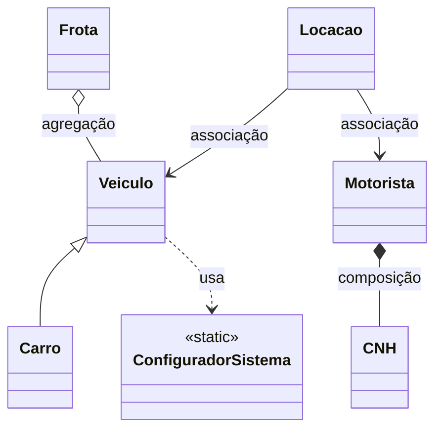

# Sprint 2 — Relacionamentos entre objetos e membros estáticos

## A. Identificação

- **Grupo:** Gabriel Soares e Samuel Elias
- **Integrantes:** Gabriel Soares, Samuel Elias
- **Número da sprint:** 2
- **Período:** --/--/2026 a --/--/2026
- **Responsável pelo acompanhamento:** Samuel Elias

## B. Objetivo da sprint

Ampliar o modelo para que os componentes do sistema interajam entre si: `Motorista` contém `CNH` (composição), `Frota` gerencia uma coleção de `Veiculo` (agregação), `Locacao` relaciona `Motorista` e `Veiculo` (associação) e `ConfiguradorSistema` mantém informações compartilhadas por meio de membros estáticos.

## C. Itens selecionados do Product Backlog

| ID | Requisito | Prioridade | Justificativa |
|---|---|---|---|
| PBI-02 | RF03 — `Motorista` e `CNH` | Alta | Não tem dependências e é pré-requisito da locação. Exige composição. |
| PBI-03 | RF04 — `Frota` | Alta | Depende apenas de `Veiculo` (Sprint 1). Exige agregação. |
| PBI-04 | RF07 — `ConfiguradorSistema` | Média | Introduz membros estáticos e fornece a taxa usada no cálculo de locação. |
| PBI-05 | RF05 — `Locacao` | Média | Depende de PBI-01 e PBI-02. Demonstra a associação entre objetos. |

## D. Planejamento das tarefas

Unidade das estimativas: **horas**.

| ID | Tarefa | Item relacionado | Responsável | Estimativa |
|---|---|---|---|---|
| T2.1 | Implementar `CNH` (validações) e `Motorista` com composição | PBI-02 | Gabriel Soares | 4h |
| T2.2 | Implementar `Frota` com lista encapsulada e rejeição de placa duplicada | PBI-03 | Samuel Elias | 4h |
| T2.3 | Implementar `ConfiguradorSistema` estático e contador de veículos | PBI-04 | Samuel Elias | 3h |
| T2.4 | Implementar `Locacao` (associação Motorista–Veiculo) | PBI-05 | Gabriel Soares | 4h |
| T2.5 | Atualizar o diagrama de classes | PBI-02 a PBI-05 | Gabriel Soares | 2h |
| T2.6 | Escrever testes de integração e dos membros estáticos | PBI-02 a PBI-05 | Samuel Elias | 4h |
| T2.7 | Atualizar backlog, documentar a sprint e registrar a retrospectiva | Todos | Gabriel Soares e Samuel Elias | 2h |

## E. Critérios de aceitação

**PBI-02 — Motorista e CNH (composição)**
- Criar `Motorista` com dados de CNH inválidos (número diferente de 11 dígitos, categoria vazia) lança `ArgumentException`.
- Não é possível criar uma `CNH` fora de `Motorista` (construtor `internal`).
- A `CNH` é criada dentro do construtor de `Motorista`.

**PBI-03 — Frota (agregação)**
- Adicionar o mesmo veículo (mesma placa) duas vezes é rejeitado.
- Remover um veículo da `Frota` **não** o destrói: o objeto continua existindo e utilizável.
- A lista de veículos não pode ser alterada diretamente de fora da classe.

**PBI-04 — ConfiguradorSistema (estático)**
- `TotalVeiculosCadastrados` aumenta em 1 a cada `new Veiculo(...)`.
- `TaxaServico` fora do intervalo de 0 a 1 lança `ArgumentException`.
- A taxa é única e compartilhada por todo o sistema.

**PBI-05 — Locacao (associação)**
- Criar locação com motorista de CNH vencida é rejeitado.
- Criar locação com dias menores ou iguais a zero, ou com motorista/veículo nulo, é rejeitado.
- O total calculado usa a diária do veículo, a quantidade de dias e a taxa do `ConfiguradorSistema`.

**Geral:** o projeto compila, a aplicação executa e há demonstração da interação entre os objetos.

## F. Entregáveis previstos

- Este documento de planejamento.
- Product Backlog atualizado ([backlog.md](../backlog.md)).
- Diagrama de classes atualizado (abaixo).
- Código-fonte com `CNH`, `Motorista`, `Frota`, `ConfiguradorSistema` e `Locacao`.
- Demonstração da interação entre os objetos.
- Evidências de testes dos relacionamentos e dos membros estáticos.
- Registro das atividades concluídas e das pendências (seções G e H).

### Diagrama de classes (previsto)

## G. Resultado da sprint

_A ser preenchido ao final da sprint, de acordo com o resultado real._

| Item ou tarefa | Situação | Evidência | Observações |
|---|---|---|---|
| T2.1 | | | |
| T2.2 | | | |
| T2.3 | | | |
| T2.4 | | | |
| T2.5 | | | |
| T2.6 | | | |
| T2.7 | | | |

## H. Retrospectiva

_A ser preenchida ao final da sprint._

- **O que funcionou bem?**
- **Quais foram as principais dificuldades?**
- **O planejamento foi adequado ao esforço necessário?**
- **O que deverá ser melhorado na próxima sprint?**