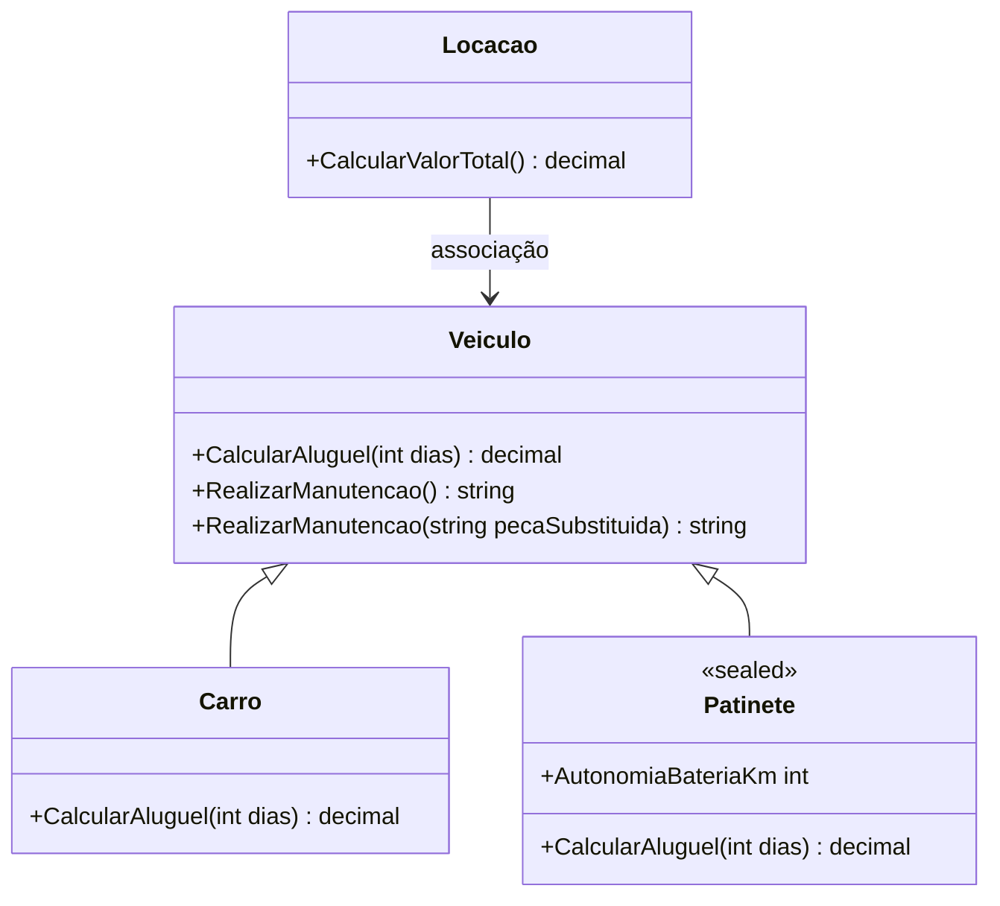

# Sprint 3 — Herança, polimorfismo e especialização

## A. Identificação

- **Grupo:** Gabriel Soares e Samuel Elias
- **Integrantes:** Gabriel Soares, Samuel Elias
- **Número da sprint:** 3
- **Período:** 19/11/2026 a 22/11/2026 (planejamento em 19/11; desenvolvimento de 20/11 a 22/11)
- **Repositório:** https://github.com/Gabriel-Srs/UrbanDrive
- **Quadro de acompanhamento:** GitHub Projects "Product Backlog"
- **Responsável pelo acompanhamento:** Gabriel Soares

## B. Objetivo da sprint

Implementar comportamentos diferentes para cada categoria de veículo sem duplicar código: `Veiculo` passa a oferecer `CalcularAluguel(int dias)` e `RealizarManutencao` (com sobrecarga), `Carro` e `Patinete` especializam o cálculo por sobrescrita, `Patinete` é uma classe `sealed`, e `Locacao` passa a calcular o valor pelo método polimórfico.

## C. Itens selecionados do Product Backlog

| ID | Requisito | Prioridade | Justificativa |
|---|---|---|---|
| PBI-06 | RF02 — `Carro` e `Patinete` (herança, `sealed`) | Alta | Depende só de `Veiculo` (Sprint 1). `Carro` já existe e precisa ser revisado. `Patinete` é novo. |
| PBI-07 | RF05 — `CalcularAluguel(int dias)` polimórfico | Alta | Depende do PBI-06. Foi isolado em `Locacao.CalcularValorTotal()` na Sprint 2 para receber esta mudança. |
| PBI-08 | RF06 — Manutenção (sobrecarga de `RealizarManutencao`) | Média | Depende do PBI-06. Exige sobrecarga, conceito obrigatório da sprint. |

**Pendência herdada da Sprint 2:** o contador estático conta um `Carro` rejeitado pelas próprias validações, porque o construtor de `Veiculo` roda antes do de `Carro` (ver T2.3 e T3.5).

## D. Planejamento das tarefas

Unidade das estimativas: **horas**.

| ID | Tarefa | Item relacionado | Responsável | Estimativa |
|---|---|---|---|---|
| T3.1 | `Veiculo`: `CalcularAluguel(int dias)` virtual (regra base: diária × dias) e `RealizarManutencao()` / `RealizarManutencao(string pecaSubstituida)` | PBI-07, PBI-08 | Gabriel Soares | 3h |
| T3.2 | `Carro`: sobrescrever `CalcularAluguel` com a regra própria | PBI-06, PBI-07 | Gabriel Soares | 2h |
| T3.3 | `Patinete` (`sealed`): autonomia da bateria, construtor com `base` e sobrescrita de `CalcularAluguel` | PBI-06, PBI-07 | Samuel Elias | 3h |
| T3.4 | `Locacao.CalcularValorTotal()` passa a usar `Veiculo.CalcularAluguel(Dias)` | PBI-07 | Gabriel Soares | 1h |
| T3.5 | Corrigir o contador estático para não contar veículo rejeitado pelas validações da subclasse | PBI-06 | Samuel Elias | 2h |
| T3.6 | Testes: cálculos polimórficos, sobrecarga, `sealed`, `Patinete` e atualização do teste da `Locacao` com `Carro` | PBI-06, 07, 08 | Samuel Elias | 3h |
| T3.7 | Diagrama de classes e backlog atualizados | Todos | Gabriel Soares | 2h |
| T3.8 | Documentar a sprint (`sprint-3.md`), resultado e retrospectiva | Todos | Gabriel Soares e Samuel Elias | 2h |

**Total estimado:** 18h (Gabriel Soares: 8h, Samuel Elias: 8h, em conjunto: 2h).

> O backlog estima 16h para PBI-06 a PBI-08. O planejamento detalhado chegou a 18h por incluir a pendência do contador (T3.5), que não estava no backlog original.

### Cronograma e prazos internos

| Data | Meta do dia |
|---|---|
| Qui 19/11 | Planejamento: `sprint-3.md` por PR, issues das tarefas criadas, issue do PBI-07 reaberta. |
| Sex 20/11 | **T3.1 integrada na `main`** (pré-requisito das demais). Início da T3.2, T3.4 e T3.3. |
| Sáb 21/11 | **Prazo interno: todos os PRs abertos até o fim do dia** (T3.2, T3.3, T3.4, T3.5, T3.6). Revisão cruzada. |
| Dom 22/11 | Merges finais, `dotnet run` com 0 reprovados, T3.7, T3.8 (resultado e retrospectiva) e entrega. |

### Ordem de integração (dependências)

1. `feature/veiculo-polimorfismo` (T3.1): integrada primeiro, pequena, porque as demais dependem dela.
2. Em paralelo, a partir da `main` atualizada: `feature/carro-aluguel` (T3.2 e T3.4) e `feature/patinete` (T3.3).
3. `fix/contador-veiculos` (T3.5), depois que T3.2 e T3.3 estiverem na `main`, pois altera os construtores.
4. `test/sprint-3` (T3.6) e `docs/sprint-3` (T3.7 e T3.8).

Toda integração é feita por **Pull Request**, com revisão do colega. Não há merge local.

### Regras de negócio adotadas

> O enunciado não define os valores. Estas regras foram escolhidas pelo grupo e são o critério dos testes.

| Tipo | Regra de `CalcularAluguel(int dias)` |
|---|---|
| `Veiculo` (base) | `ValorBaseDiaria × dias` (valida `dias > 0`) |
| `Carro` | `base.CalcularAluguel(dias) × 1,05` (acréscimo de 5% de seguro) |
| `Patinete` | `base.CalcularAluguel(dias)`, com 10% de desconto a partir de 3 dias |

A taxa de serviço do `ConfiguradorSistema` continua sendo aplicada na `Locacao`, sobre o resultado de `CalcularAluguel`. `Carro` e `Patinete` chamam `base.CalcularAluguel`, o que reaproveita a validação e evita duplicação de código.

### Decisões de projeto

| Decisão | Escolha |
|---|---|
| Unidade e limite da autonomia da bateria do `Patinete` | Quilômetros (km), maior que zero. |
| Placa do `Patinete` | Mantém a validação do `Veiculo` (padrão antigo ou Mercosul). |
| Contador de veículos (T3.5) | `RegistrarVeiculo()` sai do construtor de `Veiculo` e passa a ser chamado no fim do construtor de `Carro` e de `Patinete`. |
| Retorno de `RealizarManutencao` | `string` com a descrição, sem `Console`, conforme o padrão do projeto. |
| `Veiculo` abstrato | Fica para a Sprint 4 (PBI-12). Nesta sprint continua concreto. |

## E. Critérios de aceitação

**PBI-06 — Carro e Patinete (herança)**
- `Carro` e `Patinete` herdam de `Veiculo` e inicializam a base com `base(...)`.
- `Patinete` é `sealed`: nenhuma classe pode herdar dela.
- `Patinete` rejeita autonomia da bateria menor ou igual a zero (`ArgumentOutOfRangeException`).
- Um `Carro` ou `Patinete` rejeitado pelas próprias validações **não** aumenta o contador de veículos (T3.5).

**PBI-07 — `CalcularAluguel(int dias)` polimórfico**
- Para diária R$ 100,00 e 3 dias: `Veiculo` retorna R$ 300,00 e `Carro` retorna R$ 315,00.
- Para diária R$ 40,00: `Patinete` com 2 dias retorna R$ 80,00 e com 4 dias retorna R$ 144,00 (desconto de 10%).
- Uma lista de `Veiculo` com carro e patinete devolve o cálculo de cada tipo ao chamar `CalcularAluguel`, sem verificar o tipo.
- `dias <= 0` lança `ArgumentOutOfRangeException`.
- `Locacao.CalcularValorTotal()` = `Veiculo.CalcularAluguel(Dias) × (1 + TaxaServico)`. Exemplo: `Carro` de R$ 150,00 por 2 dias com taxa de 10% = R$ 346,50.
- O teste da `Locacao` com `Carro` da Sprint 2 (R$ 330,00) é atualizado para R$ 346,50 e a mudança é registrada.

**PBI-08 — Manutenção (sobrecarga)**
- `RealizarManutencao()` retorna a descrição de uma manutenção sem peça.
- `RealizarManutencao(string pecaSubstituida)` retorna a descrição incluindo a peça.
- Peça nula, vazia ou só com espaços lança `ArgumentException`.
- Os métodos retornam `string` e não usam `Console`.

**Geral:** o projeto compila sem avisos, o `dotnet run` termina com 0 reprovados e há demonstração de herança, sobrescrita, sobrecarga e polimorfismo.

## F. Entregáveis previstos

- Este documento de planejamento.
- Product Backlog atualizado ([backlog.md](../backlog.md)).
- Diagrama de classes atualizado ([diagrama-classes.md](../diagramas/diagrama-classes.md)).
- Código-fonte da hierarquia: `Veiculo`, `Carro` e `Patinete`.
- Demonstração dos diferentes cálculos de locação.
- Demonstração da sobrecarga de `RealizarManutencao`.
- Evidências de testes dos comportamentos especializados.
- Registro das atividades concluídas e das pendências (seções G e H).

### Melhorias da Sprint 2 aplicadas neste planejamento

| Melhoria registrada na retrospectiva | Como foi aplicada |
|---|---|
| Definir as datas da sprint no início | Período e cronograma definidos na seção A e na seção D. |
| Integrar sempre por Pull Request | Nenhum merge local; toda integração por PR. |
| Integrar mais cedo as tarefas com dependência | T3.1 integrada na sexta, antes das demais. |
| Reservar tempo para revisão cruzada | Prazo interno: PRs abertos até sábado, revisão antes do domingo. |
| Reabrir ou criar a issue do PBI-07 | Issue do PBI-07 reaberta em 19/11, antes do início da T3.2. |

### Diagrama de classes (previsto)



## G. Resultado da sprint

### Registro parcial em 26/11/2026

O período previsto (19/11 a 22/11) terminou sem que todas as tarefas fossem concluídas. O planejamento acima não foi alterado; a diferença entre o previsto e o realizado fica registrada nesta seção.

| Item ou tarefa | Situação | Evidência | Observações |
|---|---|---|---|
| T3.1 | Concluído | Commit `8e90233` (22/11), PR #29, issue #21 | `CalcularAluguel` virtual e sobrecarga de `RealizarManutencao` em `Veiculo`. Compila sem avisos; `dotnet run`: 57 aprovados, 0 reprovados. Previsto para entrar na `main` em 20/11; PR aberto em 22/11 e ainda aguardando revisão em 26/11. |
| T3.2 | Concluído | Commit `c1a426f` (26/11), branch `feature/carro-aluguel`, issue #22 | `Carro` sobrescreve `CalcularAluguel` com `base.CalcularAluguel(dias) × 1,05`. |
| T3.3 | Não concluído | — | `Patinete` (`sealed`) ainda não implementado. Responsável: Samuel Elias. |
| T3.4 | Concluído | Commit `c1a426f` (26/11), branch `feature/carro-aluguel` | `Locacao.CalcularValorTotal()` passa a usar `Veiculo.CalcularAluguel(Dias)`. O teste da `Locacao` com `Carro` mudou de R$ 330,00 para R$ 346,50, como previsto no critério de aceitação do PBI-07. **Decisão revista:** a issue #22 previa deixar esse teste falhando até a T3.6; ele foi atualizado já na T3.4 para a `main` não ficar com teste reprovado. |
| T3.5 | Não concluído | — | Correção do contador estático. Depende da T3.3. Responsável: Samuel Elias. |
| T3.6 | Parcialmente concluído | `Program.cs` (branch `feature/carro-aluguel`) | Só foi atualizado o teste da `Locacao` com `Carro` (necessário para a T3.4). Os testes dos cálculos polimórficos, da sobrecarga, do `sealed` e do `Patinete` ainda faltam. Responsável: Samuel Elias. |
| T3.7 | Parcialmente concluído | `backlog.md` e `diagrama-classes.md` (branch `docs/sprint-3`) | Backlog e diagrama atualizados com o que já foi implementado. Falta incluir o `Patinete` depois da T3.3. |
| T3.8 | Parcialmente concluído | Esta seção | Registro parcial. Falta o resultado final e a retrospectiva, feitos em conjunto ao fim da sprint. |

### Resultado final em 27/11/2026

| Item ou tarefa | Situação | Evidência | Observações |
|---|---|---|---|
| T3.1 — `Veiculo`: `CalcularAluguel` virtual e sobrecarga de `RealizarManutencao` | Concluído | PR #29 (issue #21), `Models/Veiculo.cs` | Integrada na `main` em 27/11 (prevista para 20/11). |
| T3.2 — `Carro` sobrescreve `CalcularAluguel` | Concluído | PR #32 (issue #22), `Models/Carro.cs` | `base.CalcularAluguel(dias) × 1,05`. O PR #30 original foi fechado automaticamente pelo GitHub quando a branch-base foi apagada no merge do #29; o #32 tem o mesmo conteúdo. |
| T3.3 — `Patinete` (`sealed`) | Concluído | PR #33 (issue #23), `Models/Patinete.cs` | Tarefa redistribuída entre os integrantes e executada por Gabriel Soares. Autonomia em km (> 0) e 10% de desconto a partir de 3 dias. |
| T3.4 — `Locacao` usa `CalcularAluguel` | Concluído | PR #32 (issue #22), `Models/Locacao.cs` | Teste da `Locacao` com `Carro` atualizado de R$ 330,00 para R$ 346,50. |
| T3.5 — Contador estático | Concluído | PR #34 (issue #24) | Tarefa redistribuída e executada por Gabriel Soares. `RegistrarVeiculo()` passou para o fim dos construtores de `Carro` e `Patinete`. O teste do contador da Sprint 2 passou a criar `Carro` e `Patinete`, porque `Veiculo` criado diretamente deixou de ser contado. |
| T3.6 — Testes da Sprint 3 | Concluído | PR #35 (issue #25), `TestarSprint3Aluguel`, `TestarSprint3Manutencao`, `TestarSprint3Patinete`, [evidência](../evidencias/sprint-3-testes.txt) | Tarefa redistribuída e executada por Gabriel Soares. 31 cenários novos. Total do projeto: **88 aprovados, 0 reprovados**, build com 0 avisos. |
| T3.7 — Diagrama e backlog | Concluído | [diagrama-classes.md](../diagramas/diagrama-classes.md), [backlog.md](../backlog.md) | `Patinete`, `Veiculo <\|-- Patinete` e a nova dependência do contador. PBI-06 a PBI-08 concluídos. |
| T3.8 — Documentação, resultado e retrospectiva | Concluído | Este documento | |

### Evidências

**Demonstração dos diferentes cálculos de locação (polimorfismo):**

```text
--- Polimorfismo: a mesma chamada em uma lista de Veiculo ---
  Veiculo  | 3 dias | R$ 300,00
[OK] Veiculo na lista calcula R$ 300,00: ok
  Carro    | 3 dias | R$ 315,00
[OK] Carro na lista calcula R$ 315,00: ok
  Patinete | 3 dias | R$ 108,00
[OK] Patinete na lista calcula R$ 108,00: ok

--- Locação usa o cálculo de cada tipo ---
Locação | Motorista: Ana Costa | Placa: CCC3C33 | Dias: 4 | Total: R$ 158,40
[OK] Locação de Patinete: R$ 144,00 x 1,10 (taxa) = R$ 158,40: ok
Locação | Motorista: Ana Costa | Placa: BBB2B22 | Dias: 3 | Total: R$ 346,50
[OK] Locação de Carro: R$ 315,00 x 1,10 (taxa) = R$ 346,50: ok
```

**Demonstração da sobrecarga de manutenção:**

```text
  RealizarManutencao():          Manutenção geral realizada no veículo DDD4D44.
  RealizarManutencao("bateria"): Manutenção realizada no veículo EEE5E55: bateria substituída.
[OK] Versão sem parâmetro descreve a manutenção com a placa: ok
[OK] Versão com peça inclui a peça substituída: ok
[OK] Peça vazia: A peça substituída não pode ser nula ou vazia.
```

A saída completa do `dotnet run` está em [`docs/evidencias/sprint-3-testes.txt`](../evidencias/sprint-3-testes.txt).

**Relação entre critérios de aceitação e cenários testados:**

| Critério | Cenário(s) que comprovam |
|---|---|
| PBI-06: herança com `base(...)` | Patinete é um Veiculo; construtor com `base(...)` inicializa a placa normalizada; placa inválida no Patinete (validação herdada) |
| PBI-06: `Patinete` é `sealed` | Patinete é sealed (`typeof(Patinete).IsSealed`) |
| PBI-06: autonomia ≤ 0 rejeitada | Autonomia zero; autonomia negativa; alterar autonomia para zero |
| PBI-06: veículo rejeitado não conta | Carro e Patinete rejeitados não aumentam o contador; Patinete válido aumenta em 1 |
| PBI-07: Veiculo R$ 300,00 e Carro R$ 315,00 | Regra de cada tipo |
| PBI-07: Patinete R$ 80,00 e R$ 144,00 | Patinete 2 dias; Patinete 4 dias (e 3 dias = R$ 108,00) |
| PBI-07: lista de `Veiculo` sem verificar o tipo | Polimorfismo: a mesma chamada em uma lista de Veiculo |
| PBI-07: `dias <= 0` rejeitado | Carro e Patinete com 0 dias e com dias negativos |
| PBI-07: `Locacao` usa `CalcularAluguel` | Locação de Carro = R$ 346,50; locação de Patinete = R$ 158,40 |
| PBI-08: as duas sobrecargas | Versão sem parâmetro; versão com peça |
| PBI-08: peça inválida rejeitada | Peça vazia, só com espaços e nula |

## H. Retrospectiva

**O que funcionou bem?**
- Chamar `base.CalcularAluguel(dias)` nas subclasses evitou duplicar a regra e a validação de `dias`: cada subclasse só tem a diferença do seu tipo.
- O cálculo da `Locacao` isolado em `CalcularValorTotal()` na Sprint 2 permitiu trocar para o cálculo polimórfico mudando uma única linha.
- A ordem de integração planejada (T3.1 antes das demais e a T3.5 depois do `Patinete`) evitou conflitos entre as branches.
- Os testes da Sprint 3 foram escritos a partir dos critérios de aceitação, com os valores definidos no planejamento.

**Quais foram as principais dificuldades?**
- O planejamento só entrou na `main` em 22/11, último dia do período previsto. Com isso, o desenvolvimento começou atrasado e a sprint terminou em 27/11.
- As tarefas T3.3, T3.5 e T3.6 tiveram de ser redistribuídas no fim da sprint e foram executadas por um único integrante.
- Os PRs empilhados (um criado sobre a branch do outro) causaram um problema: ao apagar a branch-base no merge do #29, o GitHub fechou o #30 em vez de mudar a base para a `main`, e foi preciso abrir o #32.

**O planejamento foi adequado ao esforço necessário?**
Quanto ao escopo e às estimativas, sim: as tarefas eram pequenas e as regras de negócio estavam definidas, o que facilitou a implementação e os testes. Quanto ao prazo, não: o período de 4 dias, com o planejamento integrado no último dia, não foi suficiente, e a sprint passou 5 dias do previsto.

**Decisões revistas**
- O teste da `Locacao` com `Carro` foi atualizado já na T3.4, e não na T3.6 como previa a issue #22, para a `main` não ficar com teste reprovado.
- Com o contador movido para as subclasses (T3.5), um `Veiculo` criado diretamente deixou de ser contado. O teste do contador da Sprint 2 foi ajustado. Isso antecipa a Sprint 4, em que `Veiculo` passa a ser abstrata.
- As tarefas T3.3, T3.5 e T3.6 foram redistribuídas entre os integrantes.

**O que deverá ser melhorado na próxima sprint?**
- Integrar o planejamento na `main` no primeiro dia da sprint.
- Evitar PRs empilhados; quando forem necessários, mudar a base para `main` antes de apagar a branch-base.
- Acompanhar o quadro no meio da sprint para redistribuir tarefas mais cedo quando um integrante estiver sem disponibilidade.